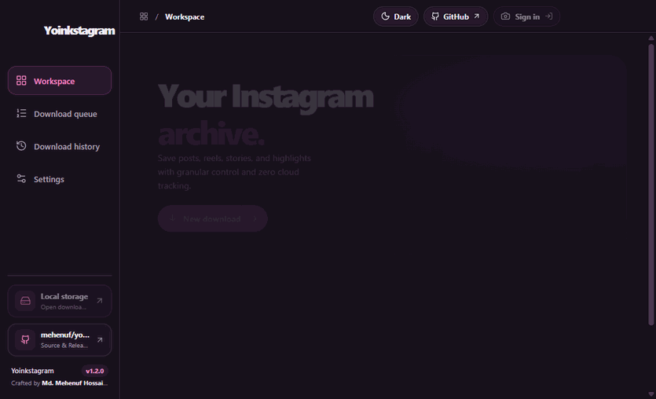
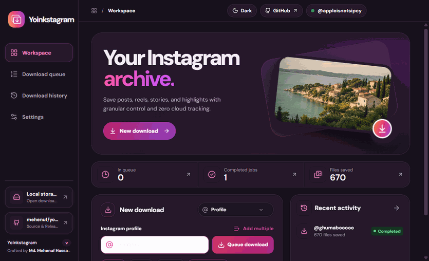
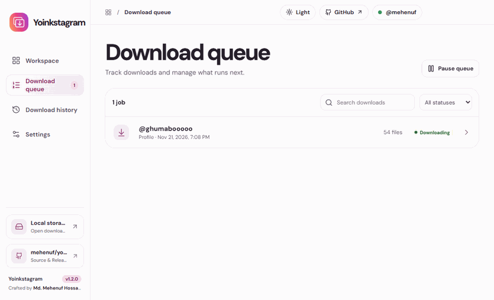

<div align="center">


# Yoinkstagram

### The High-Performance Instagram Archival Workspace for Windows

[](https://github.com/mehenuf/yoinkstagram/releases/tag/v1.2.0)
[](https://github.com/mehenuf/yoinkstagram/releases)
[](https://github.com/mehenuf/yoinkstagram/releases)
[](https://github.com/mehenuf/yoinkstagram/actions)
[](LICENSE)

<p align="center">
  <strong>Yoinkstagram</strong> is a modern, privacy-first desktop application engineered for seamless mass-downloading, structured metadata preservation, and resilient archiving of Instagram profiles, reels, stories, highlights, and posts.
</p>

<p align="center">
  <a href="https://github.com/mehenuf/yoinkstagram/releases/tag/v1.2.0"><strong>📥 Download v1.2.0 Installer</strong></a> •
  <a href="https://github.com/mehenuf/yoinkstagram/releases/tag/v1.2.0"><strong>⚡ Download Portable Edition</strong></a> •
  <a href="#features"><strong>Explore Features</strong></a> •
  <a href="#quick-start"><strong>Build from Source</strong></a>
</p>

</div>

---

## ⚡ What's New in v1.2.0

- 🔄 **Persistent Cooldown & Multi-Hour Auto-Resume**: Downloads never drop from the queue or get prematurely marked `partial` when Instagram imposes a rate limit. Tasks automatically enter a cooling-down state with progressive backoff (15m, 30m, 1h, 2h), stay in the active queue, and automatically resume exactly where they left off once the cooldown expires.
- 🌴 **GTA VI Vice City Sunset Theme**: A playful, synthwave-inspired theme featuring tropical neon hot pink and sunset orange gradients, glowing status badges, luminous chip highlights, and animated neon headline flows, accessible directly from the top bar and settings.
- 🛡️ **Anti-Ban Ultra-Safe Pacing & Human Jitter**: Conservative request pacing (3.0s - 5.0s jittered intervals) plus periodic 30-second browsing pauses every 15 requests. Guards against false "account compromised" security challenges and forced password resets.
- 🌐 **Adaptive Connection Guard & Rapid Retry**: Transient network hiccups and soft-throttling are automatically caught and retried with exponential backoff (2s, 4s) before failing individual media. 3 consecutive connection issues trigger an automatic safety cooldown to protect your account from IP blocks.
- 🎨 **Polished UI & Responsive Space Efficiency**:
  - Re-architected sidebar footer with dedicated GitHub repository card (`mehenuf/yoinkstagram`), author credit for **Md. Mehenuf Hossain Bhuiyan**, and version indicator without overlapping or squished text.
  - Eliminated dead vertical space in the Recent Activity card with expanded history view, file count metrics, and direct quick-navigation footer.
  - Real operational showcase GIFs generated directly from the live Electron desktop app.

---

## 🎬 Operational Showcase

### 1. Intuitive Target Queuing & Granular Filtering
Add any target with one click—profiles, individual reels, post carousels, or tagged collections. Configure content filters on the fly.

<div align="center">
  
</div>

<br/>

### 2. Day, Night & Vice City: Responsive Themes & Dynamic Motion
Switch seamlessly between Crisp Light, Obsidian Dark, and GTA VI Vice City Neon themes, with custom typography (DM Sans) and native Windows caption synchronization.

<div align="center">
  
</div>

<br/>

### 3. Live Archival Engine & Resumable Checkpoints
Real-time download telemetry, live log streaming, multi-hour rate-limit auto-cooldown, and persistent JSON/XZ cursor recovery.

<div align="center">
  
</div>

---

## ✨ Features at a Glance

| Feature | Description |
| :--- | :--- |
| **Comprehensive Source Support** | Save posts, reels, sidecar carousels, stories, highlights, tagged media, and followed feeds. |
| **Granular Target Filters** | Filter media by date boundaries (`after` / `before`), regex caption matchers, slide indices, or max count. |
| **Zero-Cloud Local Vault** | Account cookies (`sessionid`, `ds_user_id`, `csrftoken`) are encrypted on disk via **Windows DPAPI** (`safeStorage`). |
| **Resumable Queue Engine** | Resumes interrupted downloads where they left off using compressed checkpoint journals (`.json.xz`). |
| **Anti-Detection Pacing** | Human-mimicking jittered sleep intervals and exponential backoff safeguard your account against automated blocks. |
| **Sidecar & Rich Metadata** | Preserves caption text, comments, geotag coordinates, timestamp metadata, and raw JSON post metrics. |
| **Modern Embedded Login** | Streamlined verification window supporting Two-Factor Authentication (2FA) with automatic cookie capture. |
| **Cross-Architecture Native** | Tailored packages for 64-bit Intel/AMD (`x64`) and ARM64 devices (Snapdragon X Elite, Surface Pro). |

---

## 🏛️ System Architecture

```
┌────────────────────────────────────────────────────────┐
│                   Yoinkstagram UI                      │
│        React 19 • DM Sans • Custom Dark/Light UI       │
└───────────────────────────┬────────────────────────────┘
                            │ IPC Bridge (Preload Context)
┌───────────────────────────▼────────────────────────────┐
│              Electron Main Process (Node.js)           │
│   • Task Queue Orchestrator   • SafeStorage DPAPI      │
│   • Session Cookie Store      • Native Windows Chrome  │
└───────────────────────────┬────────────────────────────┘
                            │ Subprocess IPC (JSON Streams)
┌───────────────────────────▼────────────────────────────┐
│              Archivist Python Core (Engine)            │
│   • Instaloader Subprocess    • Web API GraphQL Engine │
│   • Resumable File Streamer   • Rate Limiting Monitor  │
└────────────────────────────────────────────────────────┘
```

---

## 📦 Downloads & Binaries (v1.1.0)

Pre-built releases are signed and packaged for modern Windows 10 and Windows 11 systems:

| Package | Architecture | Type | Direct Download Link |
| :--- | :--- | :--- | :--- |
| **Yoinkstagram Setup** | `x64` | NSIS Installer | [Yoinkstagram-Setup-1.1.0.exe](https://github.com/mehenuf/yoinkstagram/releases/tag/v1.1.0) |
| **Yoinkstagram Portable** | `x64` | Standalone Exe | [Yoinkstagram-1.1.0-portable.exe](https://github.com/mehenuf/yoinkstagram/releases/tag/v1.1.0) |
| **Yoinkstagram Package** | `x64` | Portable Zip | [Yoinkstagram-1.1.0-windows-x64.zip](https://github.com/mehenuf/yoinkstagram/releases/tag/v1.1.0) |
| **Yoinkstagram ARM64** | `arm64` | Portable Zip | [Yoinkstagram-1.1.0-windows-arm64.zip](https://github.com/mehenuf/yoinkstagram/releases/tag/v1.1.0) |

> **Note on 32-bit (x86)**: Modern Electron versions (v45+) natively target 64-bit systems. For legacy 32-bit environments, users can run the source code on a 32-bit Node.js / Python environment.

---

## 🚀 Quick Start (Building from Source)

### Prerequisites

- **Node.js**: v22.12.0 or newer
- **Python**: 64-bit Python 3.11, 3.12, or 3.13
- **Git**

### Installation & Launch

1. **Clone the repository**:
   ```powershell
   git clone https://github.com/mehenuf/yoinkstagram.git
   cd yoinkstagram
   ```

2. **Initialize Python virtual environment**:
   ```powershell
   python -m venv .venv
   .\.venv\Scripts\Activate.ps1
   pip install -r requirements.txt
   pip install "pyinstaller>=6.11,<7"
   ```

3. **Install npm dependencies**:
   ```powershell
   npm ci
   ```

4. **Launch development mode**:
   ```powershell
   npm run dev
   ```

---

## 🔨 Packaging Distributables Locally

To produce standalone Windows installers and binaries on your machine:

```powershell
# Compile React frontend and bundle standalone Python engine
npm run build
npm run build:engine

# Package Windows NSIS Installer (x64)
npm run package:setup

# Package Portable Standalone Executable (x64)
npm run package:portable

# Package Windows ARM64 Distribution (arm64)
npm run package:arm64
```

Generated outputs will be placed in the `release/` directory.

---

## 🧪 Testing & Verification

Yoinkstagram is backed by end-to-end unit tests covering IPC bridges, rate-limit backoffs, session guards, and target normalization:

```powershell
# Run frontend and Electron host unit tests
npm test

# Run Python engine tests
.\.venv\Scripts\python.exe -m unittest discover -s engine -t .
```

---

## 🔒 Security & Privacy Architecture

- **Hardware-Level Encryption**: Session tokens and cookies are secured using Windows Data Protection API (DPAPI). Only your logged-in Windows account can decrypt the session.
- **Strictly Local Storage**: Your credentials, saved media, and metadata are saved exclusively to the destination folder you designate. No remote telemetry or tracking scripts.
- **Open Source Transparency**: Every line of code orchestrating network requests and file operations is fully visible in this repository.

---

## 👤 Author & Credits

Developed with precision by **[Md. Mehenuf Hossain Bhuiyan](https://github.com/mehenuf)**.

- **GitHub**: [@mehenuf](https://github.com/mehenuf)
- **Repository**: [https://github.com/mehenuf/yoinkstagram](https://github.com/mehenuf/yoinkstagram)

If you find this project useful, please consider giving it a ⭐ on GitHub!

---

## ⚖️ License & Disclaimer

Released under the **[MIT License](LICENSE)**.

*Disclaimer: Yoinkstagram is an independent archival tool created for personal backup and educational research. It is not affiliated with, endorsed by, or sponsored by Instagram, Meta, or any related entity. Please respect creators' copyrights and platform terms of service.*
