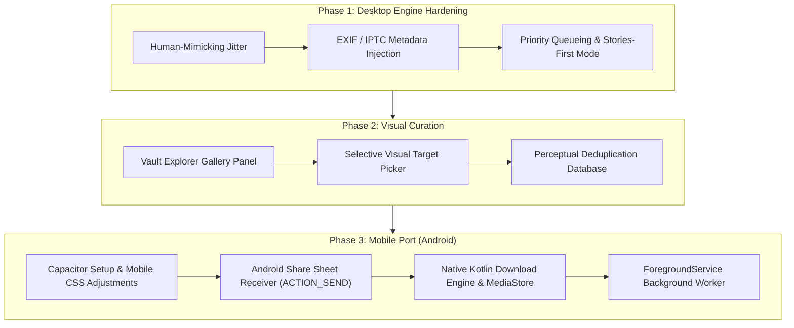

# Yoinkstagram: Competitive Research, Feature Roadmap & Android Port Feasibility

This document presents a comprehensive market analysis of modern Instagram bulk downloading and archival tools, an actionable product roadmap for Yoinkstagram, and an architectural blueprint for porting the project to Android.

---

## 1. Competitive Landscape & Market Analysis

Instagram’s aggressive anti-scraping countermeasures (rate limits, challenges, `feedback_required` GraphQL 400 errors, dynamic DOM class obfuscation) have caused widespread attrition among legacy archival tools. 

### Comparison Matrix

| Tool | Architecture | Key Strengths | Critical Pain Points & Vulnerabilities |
| :--- | :--- | :--- | :--- |
| **4K Stogram** | Commercial Desktop (C++/Qt) | Auto-subscription polling; local SQLite media database; multi-profile batching. | Rigid, machine-like request intervals cause rapid account flags/bans; expensive license model; widely abandoned due to frequent endpoint breakages. |
| **Instaloader** | Python CLI | Granular metadata extraction (JSON.XZ, comments, geotags); `--fast-update` mode; profile rename detection. | Command-line only; requires technical setup; unpatched versions trip GraphQL rate limits; no visual verification. |
| **gallery-dl** | Python CLI | High-speed multi-site extractor; advanced filename/path templating; robust OAuth/cookie session extraction. | Purely reactive (single command execution; no recurring subscription engine or local database browser). |
| **WFDownloader** | Java GUI | Robust link crawler; handles bulk account lists cleanly. | Rigid, dated UI; cookie expiration triggers silent failures; closed source. |
| **Seal** | Android App (Kotlin + `yt-dlp`) | Modern Material Design 3 UI; Android share-sheet integration; clean single-media extractor. | Focuses on single-URL / Reel / Post downloads; does not support full profile bulk scraping, stories tracking, or metadata databases. |
| **insta-dl-gui** | Open Source Desktop | GUI wrapper that delegates scraping to external commercial APIs (e.g. HikerAPI). | Requires paid third-party API subscriptions; compromises user privacy by routing requests through external providers. |

---

## 2. High-Impact New Features Roadmap

### 2.1 "Subscriptions" & Scheduled Auto-Archival
- **Overview**: Allow users to pin target accounts into an active "Subscribed" watchlist.
- **Mechanism**: A background polling daemon that runs on a user-defined schedule (e.g., every 6, 12, or 24 hours), executing an incremental check (`--fast-update`) to capture newly published posts, reels, and expiring stories automatically.
- **Value**: Restores the primary feature that drove users to 4K Stogram, without 4K Stogram's rigid request patterns.

### 2.2 EXIF & IPTC Direct Metadata Injection
- **Overview**: Embed post metadata directly into the image and video headers rather than relying solely on separate `.txt` or `.json` sidecars.
  - **IPTC / XMP Description**: Full Instagram post caption, hashtags, and original post URL.
  - **EXIF `DateTimeOriginal`**: Accurate timestamp of when the post was published.
  - **EXIF GPS Latitude / Longitude**: Embedded location coordinates when geotagged.
- **Value**: When imported into Apple Photos, Google Photos, Lightroom, or self-hosted servers (Immich, Photoprism), files are automatically organized by date, searchable by caption, and mapped geographically.

### 2.3 "Vault Explorer" (In-App Gallery & Timeline)
- **Overview**: An embedded third panel within Yoinkstagram providing an offline media browser.
- **Features**:
  - Masonry grid display of archived content across all downloaded targets.
  - Interactive filters: by creator, media type (photos, reels, carousels, stories), date range, and text search across captions.
  - Full-screen lightbox with multi-slide carousel browsing, inline video playback, and sidebar comment viewing.

### 2.4 Human-Mimicking Randomized Jitter & Anti-Detection
- **Overview**: Eliminate rigid, predictable request delays to minimize detection.
- **Mechanism**:
  - Implement randomized Gaussian delays ($4.5\text{s} \pm 2\text{s}$) between media downloads.
  - Simulate human browsing pauses: every 15–25 items, insert an extended pause ($30\text{s} - 60\text{s}$).
  - Randomize TLS fingerprint ordering and cycle standard mobile/desktop User-Agent signatures.

### 2.5 Reel Audio Detach & Speech-to-Text Transcription
- **Audio Extraction**: Option to strip and save audio tracks from Reels directly as standalone `.m4a` / `.mp3` files.
- **Local Whisper Transcription**: Optional lightweight model integration (`whisper.cpp` / Whisper Tiny) to generate `.srt` subtitle sidecars and searchable text transcripts from Reel dialogue.

### 2.6 Perceptual Deduplication Database
- **Overview**: A lightweight local SQLite database tracking media signatures using perceptual hashing (`pHash`).
- **Value**: Automatically identifies identical or reposted media across multiple accounts, offering options to link, skip, or tag duplicates to conserve storage.

---

## 3. Enhancements to Existing Features

| Feature | Current Implementation | Proposed Enhancement |
| :--- | :--- | :--- |
| **Download Queue** | Sequential queue with pause and cancel controls. | **Priority Queuing & Drag-to-Reorder**: Reorder tasks dynamically. Add a **"Stories First"** toggle to ensure ephemeral 24-hour stories are archived before long post histories. |
| **Target Filtering** | Global settings applied across all queue jobs. | **Visual Target Inspector**: Click "Inspect Target" to load a thumbnail preview grid, allowing selective picking of specific posts or carousel items before downloading. |
| **Destination Structure** | Fixed local directory. | **Dynamic Path Templating**: Support tokens such as `{target}/{year}/{month}/{media_type}/{shortcode}`. |
| **Bandwidth Controls** | Unlimited line speed. | **Configurable Throttling**: Optional speed caps (e.g., 2 MB/s, 5 MB/s) to prevent saturation of household networks. |
| **Session Vault** | Single account encrypted via Windows DPAPI. | **Multi-Account Profile Switcher**: Manage multiple burner or research accounts, switching active sessions with one click. |

---

## 4. Android Port Feasibility & Architecture

### 4.1 Feasibility Verdict: **Highly Feasible (Hybrid Native Architecture)**

Yoinkstagram’s decoupled design—a **React 19 single-page application** communicating via structured IPC with an archival engine—makes it an ideal candidate for a cross-platform mobile port.

```
┌────────────────────────────────────────────────────────┐
│             Yoinkstagram Android App                   │
├────────────────────────────────────────────────────────┤
│   UI Layer: React 19 + TypeScript (Loaded in WebView)   │
│   • Reuses ~90% of existing components & CSS styles     │
├────────────────────────────────────────────────────────┤
│   Bridge: Capacitor JS-to-Native Plugin Interface      │
├────────────────────────────────────────────────────────┤
│   Core Engine: Native Kotlin / Coroutines               │
│   • Android ForegroundService (background worker)      │
│   • MediaStore API (direct gallery integration)        │
│   • Android Share Sheet ("Share to Yoinkstagram")      │
│   • EncryptedSharedPreferences (Hardware Keystore)     │
└────────────────────────────────────────────────────────┘
```

---

### 4.2 Implementation Strategies

#### Approach A: Capacitor + Native Kotlin Engine (Recommended)
- **Concept**: Package the existing React 19 frontend with **Capacitor** (Ionic). Reimplement the Instagram request worker (`engine/download.py`) in native Kotlin using **OkHttp**, **Coroutines**, and Android's native **DownloadManager**.
- **Advantages**:
  - **Lightweight**: Total APK size under 12 MB (no Python runtime bundled).
  - **Gallery Integration**: Media files are written directly into Android's `MediaStore`, instantly appearing in Google Photos and device galleries.
  - **Process Survival**: Runs within an Android `ForegroundService` with a persistent notification, ensuring large batch downloads are not terminated by Android battery management.

#### Approach B: Capacitor + Embedded Python (Chaquopy)
- **Concept**: Embed a full CPython runtime inside the Android APK using Chaquopy, running `engine/download.py` without rewriting the scraping logic.
- **Advantages**: Maximum code reuse with minimal backend rework.
- **Trade-offs**: Adds 30–45 MB to the APK footprint; slower cold-start times; higher memory consumption on mobile devices.

#### Approach C: Desktop / NAS Companion App
- **Concept**: The Android app acts as a remote management client for the desktop or Docker/NAS version of Yoinkstagram.
- **Advantages**: Zero processing or battery load on the mobile device; storage is saved directly to home storage or cloud sync folders.

---

### 4.3 Mobile-Specific Capabilities ("Superpowers")

1. **Android Share Sheet Receiver (`ACTION_SEND`)**:
   - While browsing Instagram, users tap **Share > Yoinkstagram**. The app parses the URL, presents a bottom-sheet configuration card, and starts downloading immediately.
2. **Foreground Progress Notifications**:
   - A persistent status bar notification showing live transfer speed, active item counts, and quick-action **Pause / Cancel** buttons.
3. **Android Keystore Security**:
   - Replaces Windows DPAPI (`safeStorage`) with Android's hardware-backed `EncryptedSharedPreferences` to secure session cookies.
4. **Scoped Storage Compliance**:
   - Automatically saves media to standard `Movies/Yoinkstagram/` and `Pictures/Yoinkstagram/` directories compliant with Android 11+ storage policies.

---

## 5. Phased Implementation Roadmap


